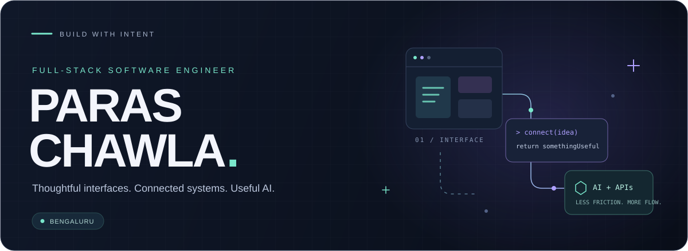
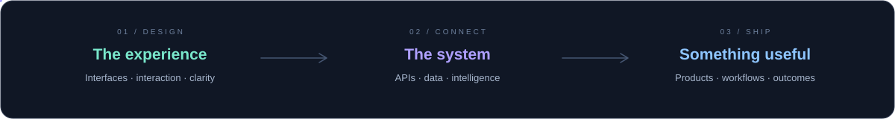

  

  <strong>From the first interaction to the last API call.</strong> 
  I build web experiences and explore AI that makes everyday work simpler.

  
  
  

  <a href="#behind-the-builds">About</a> &nbsp; / &nbsp;
  <a href="#selected-builds">Selected builds</a> &nbsp; / &nbsp;
  <a href="#my-toolbox">Toolbox</a> &nbsp; / &nbsp;
  <a href="#lets-connect">Connect</a>

## Behind the builds

Hey, I’m **Paras** 👋 — a **Full Stack Software Engineer at Bazaarvoice**, based in **Bengaluru**, and a **VIT Vellore alumnus**.

My projects span photography websites, learning platforms, and AI-assisted business workflows. I enjoy working across the stack: bringing interfaces to life, connecting APIs and data, and turning an idea into something people can use.

- **Crafting:** full-stack web experiences with React, Next.js, and TypeScript.
- **Exploring:** local LLMs, structured outputs, and tool-connected AI workflows.
- **Practicing:** data structures and algorithms in C++.

> Good software connects the details: the interface, the logic, and the person using it.

  

## Selected builds

<table>
  <tr>
    <td width="50%" valign="top">
      01 / AI-ASSISTED WORKFLOWS
      <h3><a href="https://github.com/Paraschawla21/government-business-registration-assistant">Business Registration Assistant ↗</a></h3>
      An AI-assisted project for helping first-time entrepreneurs in India navigate business registrations through structured rules, official source links, and actionable checklists, with local LLMs for constrained summaries and next steps.
        
      Next.js · TypeScript · Python · FastAPI · Ollama
        
      <a href="https://github.com/Paraschawla21/government-business-registration-assistant">Explore the code →</a>
    </td>
    <td width="50%" valign="top">
      02 / CREATIVE WEB EXPERIENCES
      <h3><a href="https://github.com/Paraschawla21/storiesbyakshat">Stories by Akshat ↗</a></h3>
      A photography and filmmaking portfolio with a full admin CMS for galleries, films, journal posts, and site content. Built to make beautiful work easy to discover and manage.
        
      Next.js · TypeScript · PostgreSQL · Prisma · Cloudinary
        
      <a href="https://storiesbyakshat.vercel.app">Visit the website →</a> · <a href="https://github.com/Paraschawla21/storiesbyakshat">Source</a>
    </td>
  </tr>
</table>

  <a href="https://github.com/Paraschawla21?tab=repositories"><strong>More experiments. More things built. Browse all repositories →</strong></a>

## My toolbox

  

| Layer | What I build with |
| :--- | :--- |
| **Interfaces** | React.js · Next.js · JavaScript · TypeScript |
| **APIs & services** | Node.js · Express.js · Python · FastAPI · Java · REST APIs |
| **Data & cloud** | MySQL · MongoDB · AWS (ECS Fargate, S3, CloudFront, ECR, Athena) |
| **Architecture & delivery** | Microservices · distributed systems · Docker · CI/CD |
| **AI-assisted development** | GitHub Copilot · Claude · Cursor · OpenCode · multi-step agent orchestration |
| **Developer tools** | Git · GitHub · Postman · C++ |
| **Accessibility** | Web accessibility · WCAG · ARIA · ADA compliance |

  
<strong>A little more of the journey</strong>

- **Creative work:** [Stories by Akshat](https://storiesbyakshat.vercel.app).
- **My corner of the web:** [React portfolio](https://portfolio-paraschawla21.vercel.app).
- **Problem-solving practice:** [LeetCode & GFG](https://github.com/Paraschawla21/leetcode_gfg) · [GFG solutions](https://github.com/Paraschawla21/gfg_codes).

## Let’s connect

Have an interesting problem at the intersection of **web products and useful AI**? Let’s talk.

**[Connect on LinkedIn ↗](https://www.linkedin.com/in/paraschawla21/)** &nbsp; · &nbsp; **[Visit my portfolio ↗](https://portfolio-paraschawla21.vercel.app)**

  

